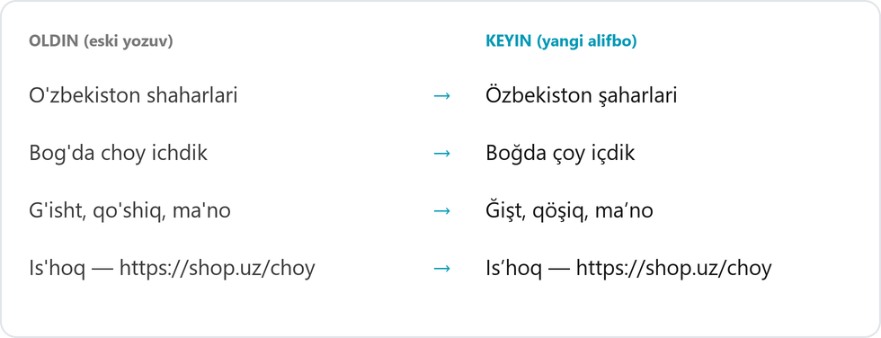

<div align="center">


# Özbeça

**O'zbekcha matnni yangi alifboga (Ö, Ğ, Ş, Ç) o'giradi — yozayotganingizda yoki bitta tugma bilan.**<br>
Word, Telegram, Chrome, Notepad, Excel, VS Code va boshqa ilovalarda — matn o'sha joyning o'zida almashadi.

<br>

<a href="https://github.com/AzamjonShaydullayev/Ozbeca/releases/latest/download/Ozbeca.exe"></a>

<sub>Bepul · ochiq kod · internetga ulanmaydi · admin huquqi shart emas · <a href="https://github.com/AzamjonShaydullayev/Ozbeca/releases">barcha versiyalar</a></sub>

</div>

<p align="center"></p>

---

## Bu nima?

2026-yil 21-oktabrda lotin yozuviga asoslangan o'zbek alifbosi yangilandi. Yangi alifboda 4 ta harf boshqacha yoziladi:

| Eski | Yangi | Misol |
|:---:|:---:|---|
| **Sh** sh | **Ş** ş | shahar → **ş**ahar |
| **Ch** ch | **Ç** ç | choy → **ç**oy |
| **Oʻ** oʻ | **Ö** ö | oʻzbek → **ö**zbek |
| **Gʻ** gʻ | **Ğ** ğ | gʻisht → **ğ**işt |

Bu harflarni klaviaturada yozish noqulay. **Özbeça** ikki yo'l bilan yordam beradi:

- **Shunchaki yozing.** Odatdagidek `choy` deb yozib probel bossangiz, so'z o'zi `çoy` ga aylanadi — telefondagi klaviaturadek.
- **Tayyor matnni o'giring.** Eski yozuvdagi matnni belgilang va <kbd>Ctrl</kbd> + <kbd>Alt</kbd> + <kbd>O</kbd> ni bosing.

---

## ⬇️ Yuklab olish va ishga tushirish (1 daqiqa)

### 1. Yuklab oling

Sahifa boshidagi **Yuklab olish** tugmasini bosing — [`Ozbeca.exe`](https://github.com/AzamjonShaydullayev/Ozbeca/releases/latest/download/Ozbeca.exe) yuklanadi.

Bitta kichik fayl. Alohida installer, .NET yoki boshqa narsa kerak emas — Windows 10 va 11 da hammasi bor. Dastur o'zini birinchi ochilganda bir bosishda o'rnatadi (3-qadam).

### 2. Ishga tushiring

Yuklab olingan `Ozbeca.exe` ni ikki marta bosing.

> [!NOTE]
> **Ko'k "Windows protected your PC" ("Windows kompyuteringizni himoya qildi") oynasi chiqadi — bu normal holat.**
>
> Ochish uchun **«More info» / «Подробнее»** → **«Run anyway» / «Выполнить в любом случае»** ni bosing. Bu faqat bir marta so'raladi.
>
> <details>
> <summary>Bu oyna nega chiqadi? Xavfsizmi?</summary>
>
> Bu Windows'ning **SmartScreen** himoyasi. U internetdan yuklangan va ikkita belgisi bo'lgan har qanday dasturda chiqadi:
> - **raqamli imzo yo'q** — imzo uchun har yili pullik sertifikat kerak bo'ladi;
> - **hali kam odam yuklab olgan.**
>
> Oyna dasturda virus borligini anglatmaydi. U faqat Windows bu dasturni hali "tanimasligini" bildiradi.
>
> Özbeça xavfsiz:
> - **kodi to'liq ochiq** — bu sahifada istalgan kishi ko'rib chiqishi mumkin;
> - **internetga ulanmaydi** va hech qanday ma'lumot yubormaydi;
> - **administrator huquqi so'ramaydi**;
> - **yozganlaringizni saqlamaydi** — batafsil: [Maxfiylik](#-maxfiylik).
>
> Xohlasangiz, faylni [VirusTotal](https://www.virustotal.com/) saytida 70 dan ortiq antivirus bilan tekshirib ko'rishingiz mumkin.
> </details>

### 3. O'rnatish oynasida «Boshlash» ni bosing

Birinchi ochilganda dastur nimalarni qilishni so'raydi. Hammasi oldindan belgilangan — **Boshlash** ni bossangiz bo'ldi:

<p align="center"></p>

| Belgi | Nima qiladi |
|---|---|
| **Shunchaki yozing** | Yozish paytida avtomatik o'girish. Keyin tray menyusidan bir bosishda o'chirsa bo'ladi |
| **Kompyuterga o'rnatish** | Dastur `%LocalAppData%\Programs\Ozbeca` ga ko'chiriladi. Yuklab olingan faylni keyin o'chirib tashlasangiz bo'ladi |
| **Ish stolida yorliq** | Ish stolida **Özbeça** belgisi paydo bo'ladi |
| **Start menyusiga qo'shish** | Start menyusida "Özbeça" deb qidirsangiz topiladi |
| **Kompyuter yoqilganda ishga tushirish** | Dastur o'zi ochiladi va jim kutib turadi |

Shundan keyin dastur oyna ochmaydi. U ekranning pastki o'ng burchagida, soat yonida  **Ö** belgisi bo'lib turadi. Belgi ko'rinmasa, **^** (yashirin belgilar) tugmasini bosing.

---

## ✍️ Qanday foydalaniladi

### Yozish paytida

Hech narsa qilish shart emas — odatdagidek yozing:

| Yozasiz | Probel bosilgach |
|---|---|
| `choy ` | `çoy ` |
| `O'zbekiston ` | `Özbekiston ` |
| `bog'da ` | `boğda ` |

- **Ctrl+V** bilan uzun matn qo'ysangiz ham o'giriladi (bir nechta so'zli matn bo'lsa).
- So'zni o'zgartirmoqchi bo'lmasangiz — <kbd>Ctrl</kbd>+<kbd>Z</kbd>.
- Vaqtincha kerak bo'lmasa: Ö belgisi ustida o'ng tugma → **Yozish paytida o'girish** belgisini olib tashlang.

### Tayyor matnni o'girish

1. O'girmoqchi bo'lgan qismni **belgilang** (hammasi uchun <kbd>Ctrl</kbd>+<kbd>A</kbd>).
2. <kbd>Ctrl</kbd> + <kbd>Alt</kbd> + <kbd>O</kbd> ni bosing.
3. Matn o'girildi, yonida **"Özbeça ✓"** chiqadi. Bekor qilish — <kbd>Ctrl</kbd>+<kbd>Z</kbd>.

> 💡 Eslab qolish oson: **O** → **Ö**.

### Kod yozayotganda

Kod muharrirlarida (VS Code, Visual Studio, JetBrains, Cursor, Notepad++ va boshqalar) dastur kodga tegmaydi — **faqat qo'shtirnoq ichidagi matnni** o'giradi:

```js
console.log("Bugun choy ichdik");   // →  console.log("Bugun çoy içdik");
const shahar_id = getChoy();        // →  o'zgarmaydi
```

Brauzerda kod yozsangiz ham `user_name`, `print(choy)`, `shop.check`, `showChart` kabi kodga o'xshash so'zlar o'zgarmaydi.

### Qayerda o'zi o'chiq turadi

Terminallar (cmd, PowerShell, Windows Terminal), parol maydonlari, parol menejerlari, masofaviy ish stoli va administrator oynalarida yozish paytida o'girish ishlamaydi.

Probelsiz Enter bosilsa ham oxirgi so'z o'giriladi (`Yaxshimisan?` + Enter → `Yaxşimisan?`) — lekin faqat parol maydoni bo'lmasa. Oxirgi so'zdan keyin sichqoncha bilan **Yuborish** tugmasi bosilsa, o'sha so'z o'girilmaydi — probel yoki Enter bosing.

---

## ✨ Imkoniyatlar

- **Deyarli hamma joyda ishlaydi.** Notepad, Word, Excel, Chrome, Telegram, VS Code, terminal, hatto Explorer'da fayl nomini o'zgartirishda ham.
- **Telegram'da stillar saqlanadi.** Qalin, chiziqli matn va premium emoji o'girilgandan keyin ham joyida qoladi.
- **Aralash matnni tushunadi.** Eski yozuv, yangi yozuv yoki ikkalasi aralash bo'lsa ham to'g'ri o'giradi. Allaqachon yangi alifboda yozilgan qism o'zgarmaydi.
- **Tutuq belgisining hamma xilini taniydi:** `'` `` ` `` `’` `‘` `ʻ` `ʼ` `´` `′`. Kim qanday yozgan bo'lsa ham, `o'`, `o‘`, `o`` va boshqalar `ö` ga aylanadi.
- **Kerakmas joyga tegmaydi.** Havolalar, email, `@username` va `#hashtag` o'zgarmaydi. Tirnoqni tutuq deb adashtirmaydi: `'kino'` va `'tong'` shundayligicha qoladi.
- **Clipboard'ingiz buzilmaydi.** Oldin nima nusxalagan bo'lsangiz, o'girishdan keyin o'sha joyida qoladi. Win+V tarixiga ortiqcha narsa tushmaydi.
- **Tutuqsiz yozilganini ham tuzatadi.** `ozbek`, `togri`, `kop` → `özbek`, `töğri`, `köp`. Faqat bir ma'noli so'zlar: `qol` (qol/qo'l), `ot` (ot/o't), `bor` (bor/bo'r) kabilarga tegilmaydi.
- **Yengil.** Bitta ~0.25 MB fayl, internetga ulanmaydi, administrator huquqi so'ramaydi.

---

## 🔤 Qanday o'giradi

| Yozilgan | Natija | Qoida |
|---|---|---|
| `O'zbekiston`, `o‘zbek`, `o`rta` | `Özbekiston`, `özbek`, `örta` | o + tutuq → **ö** |
| `G'ALABA`, `bog'`, `tog'da` | `ĞALABA`, `boğ`, `toğda` | g + tutuq → **ğ** (so'z oxirida ham) |
| `shahar`, `Shahar`, `SHAHAR` | `şahar`, `Şahar`, `ŞAHAR` | sh → **ş** |
| `choy`, `Chorshanba` | `çoy`, `Çorşanba` | ch → **ç** |
| `ma'no`, `san'at`, `she'r` | `maʼno`, `sanʼat`, `şeʼr` | harflar orasidagi tutuq → rasmiy **ʼ** |
| `Is'hoq`, `as'hob` | `Isʼhoq`, `asʼhob` | s va h alohida tovush bo'lsa, ş bo'lmaydi |
| `Ishoq`, `ashob` | `Isʼhoq`, `asʼhob` | tutuqsiz yozilgani ham tuzatiladi |
| `ozbek`, `togri`, `Fargona` | `özbek`, `töğri`, `Farğona` | tutuqsiz yozilgan so'z — lug'at bo'yicha tuzatiladi |
| `qol`, `ot`, `bor`, `yoq` | o'zgarmaydi | ikki ma'noli (qol/qo'l, ot/o't) — qaysi biri ekanini bilib bo'lmaydi |
| `o' harfi` | `ö harfi` | yakka o' ham |
| `tong`, `keng`, `dengiz` | o'zgarmaydi | **ng** o'z holicha qoladi |
| `Bu 'kino' edi`, `'tong'` | o'zgarmaydi | tirnoq tutuq deb olinmaydi |
| `https://shop.uz/choy`, `info@shahar.uz` | o'zgarmaydi | havola va email |

Qoidalar quyidagi rasmiy manbalarga asoslangan:
- [OʻRQ-1184-son Qonun (21.10.2026)](https://lex.uz/uz/docs/8548754) — 28 harf va tutuq belgisi **ʼ** (U+02BC);
- [Oʻzbek tilining asosiy imlo qoidalari (1995)](https://lex.uz/docs/1625271).

---

## ⚙️ Sozlamalar

Sozlamalarni ochish: soat yonidagi **Ö** belgisini yoki ish stolidagi **Özbeça** yorlig'ini bosing. Oynani **−** bilan kichraytirsangiz, u yana Ö belgisiga yashirinadi — dastur ishlashda davom etadi.

<p align="center"></p>

- **Özbeça yoqilgan** (chap paneldagi tugma) — dasturni butunlay vaqtincha o'chiradi.
- **Belgilab o'girish** — **O'zgartirish** ni bosib, yangi kombinatsiyani bosing. U darhol tekshiriladi: boshqa dastur egallagan bo'lsa, ogohlantirish chiqadi.
- **Yozish paytida** — yozish paytida avtomatik o'girish.
- **Tutuqsiz so'zlar** — `ozbek` → `özbek` kabi. Lug'atda ~9 000 so'z bor, ular ochiq o'zbekcha matnlardan olingan. Ikki ma'noli so'zlar (`qol`, `ot`, `bor`) lug'atga kiritilmagan.
- **Xabar ko'rsatish** — "Özbeça ✓" xabari.
- **Windows bilan** — kompyuter yoqilganda ishga tushadi.

**Tray menyusi** (Ö belgisi ustida o'ng tugma): Yoqilgan · Yozish paytida o'girish · Kompyuter yoqilganda ishga tushirish · Sozlamalar… · Chiqish.

---

## 🔒 Maxfiylik

- Dastur **internetga umuman ulanmaydi** va hech narsa yubormaydi.
- **Yozish paytida o'girish** yoqilganda dastur qaysi tugmalar bosilganini ko'radi — **faqat joriy so'zni** bilish uchun. Xotirada eng ko'pi bitta qator turadi, u **diskka yozilmaydi** va probel, Enter, sichqoncha bosilganda unutiladi.
- Bu funksiyani o'chirsangiz, klaviatura kuzatilmaydi — faqat <kbd>Ctrl</kbd>+<kbd>Alt</kbd>+<kbd>O</kbd> (Windows'ning `RegisterHotKey` funksiyasi) qoladi.
- Kodi to'liq ochiq: [`src/Ozbeca.App/AutoType.cs`](src/Ozbeca.App/AutoType.cs).

---

## ✅ Qayerlarda sinalgan

| Ilova | Belgilab o'girish | Yozish paytida | Ctrl+V |
|---|:---:|:---:|:---:|
| Notepad, Word | ✅ | ✅ | ✅ |
| Chrome (input, textarea) | ✅ | ✅ | ✅ |
| Excel (katak va tahrirlash rejimi) | ✅ | | |
| Telegram Desktop (stillar bilan) | ✅ | | |
| VS Code | ✅ | ✅ faqat qo'shtirnoq ichi | — |
| Windows Terminal, cmd | ✅ | — o'chiq | — |
| Explorer — fayl nomini o'zgartirish | ✅ | | |

Batafsil natijalar: [docs/M4_SINOV.md](docs/M4_SINOV.md). Yozish paytida o'girish uchun avtomatik sinov: [tools/e2e](tools/e2e).

---

## ❓ Savollar va muammolar

<details>
<summary><b>Yozayotganimda keraksiz so'z o'zgarib ketdi</b></summary>

<kbd>Ctrl</kbd>+<kbd>Z</kbd> ni bosing — so'z qaytadi. Inglizcha yozayotgan bo'lsangiz (`check` → `çeck`), Ö belgisi ustida o'ng tugma → **Yozish paytida o'girish** ni vaqtincha o'chiring.
</details>

<details>
<summary><b>Notepad'da "tört" o'zi "tort" bo'lib qoldi</b></summary>

Bu Windows 11 Notepad'ning **o'z avto-tuzatishi**: u ba'zi so'zlarni inglizcha lug'atdagi so'zga "tuzatadi" (Özbeça o'chiq bo'lsa ham shunday bo'ladi). Notepad'da ⚙️ Sozlamalar → **Imlo tekshiruvi / Spelling** → **Avto-tuzatish / Autocorrect** ni o'chirib qo'ying.
</details>

<details>
<summary><b>Hech narsa bo'lmadi / "Matn belgilanmagan" chiqdi</b></summary>

Avval matnni belgilang (sichqoncha bilan yoki <kbd>Ctrl</kbd>+<kbd>A</kbd>), keyin tugmalarni bosing. Shu xabar chiqmasa, sozlamalarda **Yoqilgan** turganini tekshiring.
</details>

<details>
<summary><b>"Tahrirlashga ruxsat yo'q" chiqdi (Word)</b></summary>

Hujjat **himoyalangan ko'rinishda** (Protected View) ochilgan. Bu internetdan yoki Telegram'dan yuklangan fayllarda bo'ladi. Yuqoridagi sariq qatordagi **«Tahrirlashni yoqish» / «Разрешить редактирование»** tugmasini bosing va qayta urinib ko'ring.
</details>

<details>
<summary><b>"… boshqa dasturda band" degan xabar chiqdi</b></summary>

Tanlangan tugmalar kombinatsiyasini boshqa dastur egallab olgan. Sozlamalar oynasi o'zi ochiladi: **O'zgartirish** ni bosing va boshqa kombinatsiyani tanlang, masalan <kbd>Win</kbd>+<kbd>Alt</kbd>+<kbd>Space</kbd>.
</details>

<details>
<summary><b>Antivirus ogohlantirdi</b></summary>

Yozish paytida o'girish uchun dastur Windows'ning klaviatura hook'idan foydalanadi — ba'zi antiviruslar bunday dasturlarni ehtiyotdan belgilashi mumkin. Dastur internetga ulanmaydi va yozganlaringizni saqlamaydi ([Maxfiylik](#-maxfiylik)), kodi ochiq. Xohlasangiz, bu funksiyani o'chirib qo'yishingiz mumkin.
</details>

<details>
<summary><b>Dasturni qayta ochsam faqat sozlamalar chiqyapti</b></summary>

Bu to'g'ri: dastur allaqachon ishlab turibdi, shuning uchun ikkinchi nusxa ochilmaydi, faqat sozlamalar ko'rsatiladi.
</details>

<details>
<summary><b>"Administrator huquqidagi oynada ishlamaydi"</b></summary>

Administrator sifatida ochilgan dasturlarga Windows oddiy dasturlarning tugma yuborishini xavfsizlik uchun taqiqlaydi. Bu Windows'ning himoyasi, uni chetlab o'tmaymiz.
</details>

<details>
<summary><b>Word'da qalin yoki rangli harflar oddiy bo'lib qoldi</b></summary>

Belgilab o'girishda Word'ga oddiy matn qo'yiladi, shuning uchun belgilangan joydagi aralash formatlash (qalin, kursiv, rang) bitta formatga tushadi. Yozish paytida o'girishda bu muammo yo'q. Telegram'da esa ikkala holatda ham stillar saqlanadi.
</details>

<details>
<summary><b>Terminalda matn almashmadi, oxiriga qo'shildi</b></summary>

Terminal kiritilgan matnni almashtirishga imkon bermaydi — o'girilgan matn kursor turgan joyga qo'yiladi. Terminalda dastur xavfsiz tugmalarni ishlatadi (Ctrl+Insert / Shift+Insert), shuning uchun ishlab turgan buyruq to'xtab qolmaydi.
</details>

---

## 🗑️ O'chirish

1. Ö belgisi ustida o'ng tugma → **Kompyuter yoqilganda ishga tushirish** belgisini olib tashlang.
2. Shu menyuda **Chiqish** ni bosing.
3. Ish stolidagi va Start menyusidagi **Özbeça** yorliqlarini o'chiring.
4. <kbd>Win</kbd>+<kbd>R</kbd> → `%LocalAppData%\Programs\Ozbeca` → papkani o'chiring (dasturning o'zi).
5. <kbd>Win</kbd>+<kbd>R</kbd> → `%AppData%\Ozbeca` → papkani o'chiring (sozlamalar).

---

## 🛠️ Dasturchilar uchun

C#, WPF, **.NET Framework 4.8** — u Windows 10/11 tarkibida bor, shuning uchun exe ~0.25 MB. O'girish mantig'i alohida, Windows'ga bog'liq bo'lmagan `netstandard2.0` kutubxonada va 420 dan ortiq unit test bilan himoyalangan; bu kod exe ichiga kompilyatsiya qilinadi.

Tutuqsiz so'zlar lug'ati (`src/Ozbeca.Core/words.txt`) `tools/wordlist/build_wordlist.py` bilan yasalgan. Manba — [Leipzig Corpora Collection](https://wortschatz.uni-leipzig.de/) (uzb_community_2017, uzb_wikipedia_2021_100K, CC BY 4.0). Ikki ma'noli so'zlarni chiqarib tashlash uchun [uz-hunspell](https://github.com/uzbek-net/uz-hunspell) faqat tekshiruvda ishlatiladi.

```
src/Ozbeca.Core/         Transliterator (qoidalar), TokenBuffer (yozish paytida, kod rejimi),
                         CodeGuard (kodga tegmaslik), TelegramTags (Telegram stillari)
src/Ozbeca.App/          AutoType (klaviatura hook'i), ConvertEngine (hotkey), ClipboardSwap,
                         sozlamalar, o'rnatish oynasi, toast, tray
tests/Ozbeca.Core.Tests/ xUnit testlar (.NET 8)
tools/e2e/               real ilovalarda avtomatik sinov: run_autotype_tests.bat
tools/wordlist/          tutuqsiz so'zlar lug'atini yasash (korpusdan)
tools/                   ikonka va README rasmlarini yasash
```

```bash
dotnet test
```

```bash
dotnet build src/Ozbeca.App -c Release
```

Natija: `src/Ozbeca.App/bin/Release/net48/Ozbeca.exe`.

Takliflar va xatolar uchun **[Issues](https://github.com/AzamjonShaydullayev/Ozbeca/issues)** bo'limiga yozing.
