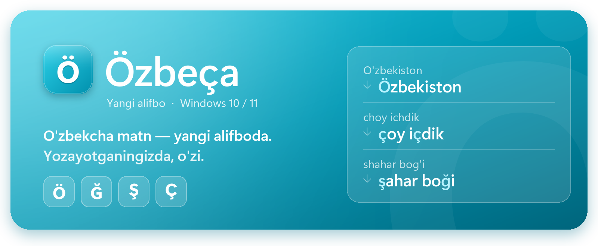
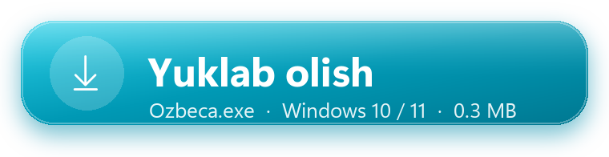
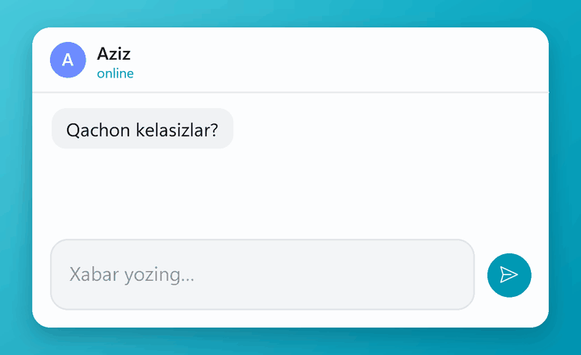
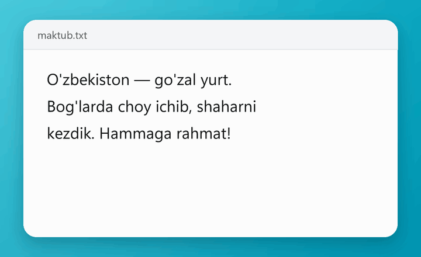
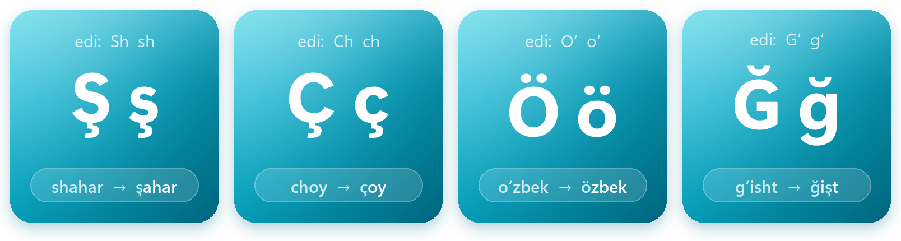
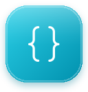
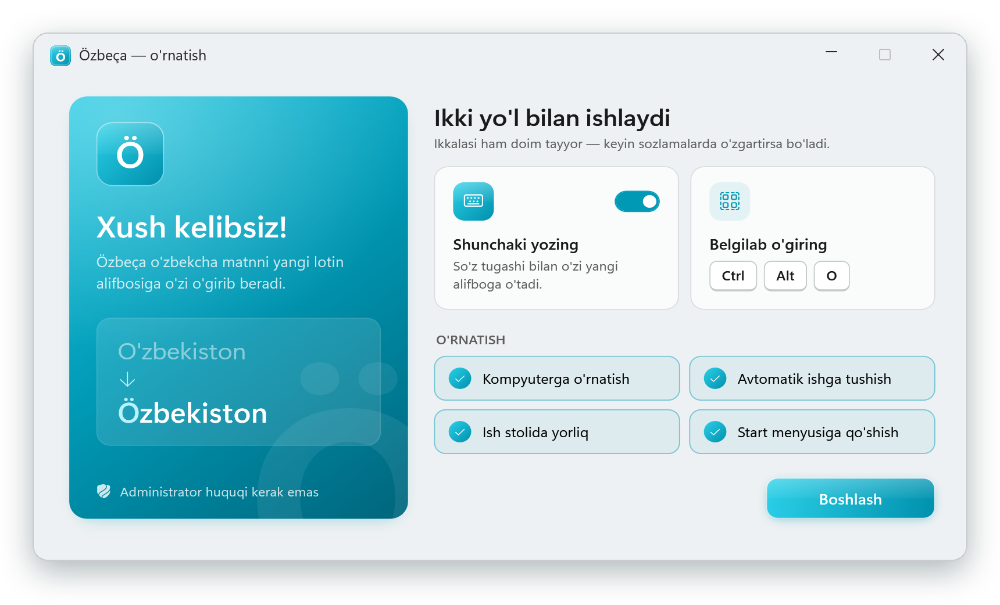
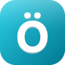
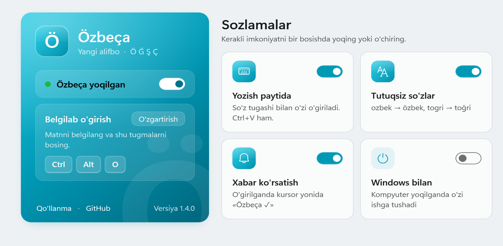
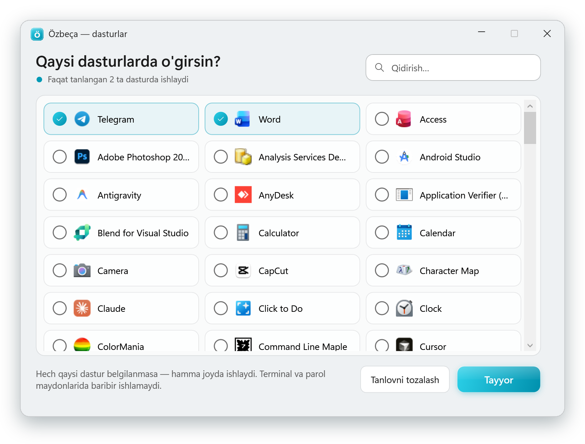

<p align="center">
  
</p>

<p align="center">
  <b>O'zbekcha matnni yangi lotin alifbosiga o'giradi — yozayotganingizda, o'zi.</b><br>
  Telegram, Word, Chrome, Excel, Notepad, VS Code — matn o'sha joyning o'zida almashadi.
</p>

<p align="center">
  <a href="https://github.com/AzamjonShaydullayev/Ozbeca/releases/latest/download/Ozbeca.exe">
    
  </a>
</p>

<p align="center">
  <sub>Bepul&nbsp;&nbsp;·&nbsp;&nbsp;ochiq kod&nbsp;&nbsp;·&nbsp;&nbsp;internetga ulanmaydi&nbsp;&nbsp;·&nbsp;&nbsp;admin huquqi shart emas&nbsp;&nbsp;·&nbsp;&nbsp;<a href="https://github.com/AzamjonShaydullayev/Ozbeca/releases">barcha versiyalar</a></sub>
</p>

<br>

<table>
  <tr>
    <td width="50%" valign="top">
      
      <h3>✍️ Shunchaki yozing</h3>
      Odatdagidek yozasiz — probel yoki Enter bosilishi bilan so'z o'zi yangi alifboga o'tadi. Telefondagi klaviaturadek.
    </td>
    <td width="50%" valign="top">
      
      <h3>⚡ Belgilang va bosing</h3>
      Tayyor matnni belgilab <kbd>Ctrl</kbd> + <kbd>Alt</kbd> + <kbd>O</kbd> ni bosing — butun matn bir zumda o'giriladi.
    </td>
  </tr>
</table>

<br>

## Yangi alifbo — 4 ta harf

2026-yil 21-oktabrda o'zbek lotin alifbosi yangilandi ([OʻRQ-1184-son Qonun](https://lex.uz/uz/docs/8548754)). Endi 4 ta harf boshqacha yoziladi. Ularni klaviaturada terish noqulay — **Özbeça** shu ishni o'zi qiladi.

<p align="center"></p>

<br>

## Imkoniyatlar

<table>
  <tr>
    <td width="33%" valign="top">
      <br>
      <b>Yozish paytida o'giradi</b><br>
      <sub>Probel, Enter yoki Ctrl+V bilan qo'yilgan matn ham — hech narsa bosish shart emas.</sub>
    </td>
    <td width="33%" valign="top">
      <br>
      <b>Tutuqsiz so'zlarni tuzatadi</b><br>
      <sub><code>ozbek</code> → <code>özbek</code>, <code>togri</code> → <code>töğri</code>. Lug'atda ~9 000 so'z, ikki ma'noli so'zlarga tegmaydi.</sub>
    </td>
    <td width="33%" valign="top">
      <br>
      <b>Siz tanlagan dasturlarda</b><br>
      <sub>Faqat Telegram va Word'da ishlasinmi? Belgilab qo'ying. Tanlamasangiz — hamma joyda.</sub>
    </td>
  </tr>
  <tr>
    <td valign="top">
      <br>
      <b>Telegram stillari saqlanadi</b><br>
      <sub>Qalin, chiziqli matn va premium emoji o'girilgandan keyin ham joyida qoladi.</sub>
    </td>
    <td valign="top">
      <br>
      <b>Kodga tegmaydi</b><br>
      <sub>VS Code, JetBrains, Cursor'da faqat <code>"qo'shtirnoq"</code> ichidagi matn o'giriladi.</sub>
    </td>
    <td valign="top">
      <br>
      <b>Clipboard buzilmaydi</b><br>
      <sub>Nusxalagan narsangiz o'girishdan keyin ham joyida. Win+V tarixi toza qoladi.</sub>
    </td>
  </tr>
  <tr>
    <td valign="top">
      <br>
      <b>Aqlli o'giradi</b><br>
      <sub>Havola, email, <code>@username</code>, <code>#hashtag</code> o'zgarmaydi. <code>'kino'</code> dagi tirnoq tutuq deb olinmaydi.</sub>
    </td>
    <td valign="top">
      <br>
      <b>Maxfiy</b><br>
      <sub>Internetga ulanmaydi, yozganlaringizni saqlamaydi, hech narsa yubormaydi.</sub>
    </td>
    <td valign="top">
      <br>
      <b>Yengil</b><br>
      <sub>Bitta 0.3 MB fayl. Installer, .NET yoki administrator huquqi kerak emas.</sub>
    </td>
  </tr>
</table>

<br>

## O'rnatish — 1 daqiqa

**1. Yuklab oling.** Yuqoridagi tugmani bosing — [`Ozbeca.exe`](https://github.com/AzamjonShaydullayev/Ozbeca/releases/latest/download/Ozbeca.exe) yuklanadi. Windows 10 va 11 da boshqa hech narsa kerak emas.

**2. Ishga tushiring.** Faylni ikki marta bosing.

> [!NOTE]
> **Ko'k "Windows protected your PC" oynasi chiqsa — bu normal.** **More info** / **Подробнее** → **Run anyway** / **Выполнить в любом случае** ni bosing. Bu faqat bir marta so'raladi.
>
> <details>
> <summary>Nega chiqadi? Xavfsizmi?</summary>
>
> Bu Windows'ning **SmartScreen** himoyasi. U raqamli imzosi yo'q (imzo har yili pullik) va hali kam yuklab olingan har qanday dasturda chiqadi — virus borligini anglatmaydi.
>
> Özbeça kodi to'liq ochiq, internetga ulanmaydi, administrator huquqi so'ramaydi va yozganlaringizni saqlamaydi ([Maxfiylik](#-maxfiylik)). Xohlasangiz, faylni [VirusTotal](https://www.virustotal.com/) da 70 dan ortiq antivirus bilan tekshiring.
> </details>

**3. «Boshlash» ni bosing.** Hammasi oldindan belgilangan:

<p align="center"></p>

| | |
|---|---|
| **Shunchaki yozing** | Yozish paytida avtomatik o'girish |
| **Kompyuterga o'rnatish** | Dastur `%LocalAppData%\Programs\Ozbeca` ga ko'chadi — yuklangan faylni o'chirsangiz bo'ladi |
| **Avtomatik ishga tushish** | Kompyuter yoqilganda jim kutib turadi |
| **Ish stolida yorliq** · **Start menyusi** | Özbeça'ni topish oson bo'ladi |

Tayyor. Dastur soat yonida  **Ö** belgisi bo'lib turadi (ko'rinmasa — **^** tugmasini bosing). Eski versiya o'rnatilgan bo'lsa, u o'zi yangilanadi, sozlamalaringiz saqlanadi.

<br>

## Qanday ishlatiladi

### ✍️ Yozish paytida

Hech narsa qilish shart emas — odatdagidek yozing:

| Yozasiz | Natija |
|---|---|
| `choy` + probel | `çoy` |
| `O'zbekiston` + probel | `Özbekiston` |
| `Yaxshimisan?` + Enter | `Yaxşimisan?` |
| Ctrl+V: `Bog'da choy ichdik` | `Boğda çoy içdik` |
| `check`, `How are you shah` | o'zgarmaydi (inglizcha) |

- So'z o'zgarishini istamasangiz — darhol <kbd>Backspace</kbd>: so'z yozganingizdek qaytadi (`çess` → `chess`) va qayta o'girilmaydi. Bir so'zni ikki marta qaytarsangiz, u **istisnolarga** qo'shiladi va boshqa o'girilmaydi.
- Inglizcha so'zlar (`check`, `should`, `school`, `which`…) va inglizcha gap davomi (`How are you shah`) yozish paytida o'zgarmaydi.
- Vaqtincha o'chirish:  belgisi ustida o'ng tugma → **Yozish paytida o'girish**. Faqat bitta dastur uchun: **Shu dastur uchun** → Matn / Kod / O'chiq. **Ctrl+V da** va **pauzada** o'girishni ham shu menyudan o'chirish mumkin.

### ⚡ Tayyor matnni o'girish

1. Matnni **belgilang** (hammasi uchun <kbd>Ctrl</kbd>+<kbd>A</kbd>).
2. <kbd>Ctrl</kbd> + <kbd>Alt</kbd> + <kbd>O</kbd> ni bosing — eslab qolish oson: **O → Ö**.
3. Yonida **«Özbeça ✓»** chiqadi. Bekor qilish — <kbd>Ctrl</kbd>+<kbd>Z</kbd>.

- Hech narsa belgilanmasa — kursordan qator boshigacha bo'lgan matn o'giriladi.
- **Kirill** matn ham yangi lotinga o'giriladi: `Ўзбекистон` → `Özbekiston`.
- **Teskari** (yangi harflarni qabul qilmaydigan saytlar uchun): <kbd>Ctrl</kbd>+<kbd>Alt</kbd>+<kbd>Shift</kbd>+<kbd>O</kbd> — `Özbekiston` → `O'zbekiston`.

### 💻 Kod yozayotganda

Kod muharrirlarida (VS Code, Visual Studio, JetBrains, Cursor, Notepad++ va b.) faqat **qo'shtirnoq ichidagi matn** o'giriladi:

```js
console.log("Bugun choy ichdik");   // →  console.log("Bugun çoy içdik");
const shahar_id = getChoy();        // →  o'zgarmaydi
```

### 🛡️ Qayerda o'zi o'chiq turadi

Terminallar (cmd, PowerShell, Windows Terminal), parol maydonlari, parol menejerlari, masofaviy ish stoli va administrator oynalarida yozish paytida o'girish ishlamaydi — u yerda bitta harf ham muhim.

<br>

## ⚙️ Sozlamalar

Soat yonidagi  belgisini yoki ish stolidagi **Özbeça** yorlig'ini bosing. **−** bilan kichraytirsangiz, oyna yana Ö belgisiga yashirinadi.

<p align="center"></p>

| | |
|---|---|
| **Özbeça yoqilgan** | Dasturni butunlay vaqtincha o'chiradi |
| **Belgilab o'girish** | **O'zgartirish** → yangi kombinatsiyani bosing. Band bo'lsa, darhol aytadi |
| **Yozish paytida** | Yozish paytida avtomatik o'girish |
| **Tutuqsiz so'zlar** | `ozbek` → `özbek`. Ikki ma'noli so'zlar (`qol`, `ot`, `bor`) o'zgarmaydi |
| **Xabar ko'rsatish** | O'girilganda kursor yonida «Özbeça ✓» |
| **Windows bilan** | Kompyuter yoqilganda ishga tushadi |
| **Ctrl+V da** | Qo'yilayotgan oddiy matnni ham o'girish (formatli matn, parol maydoni, Excel kataklariga tegilmaydi). Standart o'chiq |
| **Pauzada** | 1 soniya to'xtasangiz, probelsiz o'girish. Standart o'chiq — login va email yozishda xalaqit beradi |
| **Inglizchaga tegmaslik** | `check`, `show` va `the`, `you`, `please` dan keyingi so'z o'zgarmaydi |
| **Yangi versiya** | Kuniga bir marta GitHub'dagi versiya raqamini tekshiradi. Standart o'chiq |
| **Qaysi dasturlarda** | Yozish paytida o'girish faqat tanlangan dasturlarda ishlaydi |
| **O'girilmaydigan so'zlar** | Ismlar, brendlar, loginlar — hech qachon o'zgarmaydi |

### Qaysi dasturlarda ishlasin

**Tanlash** ni bosing — kompyuterdagi hamma dasturlar (Store ilovalari ham) ikonkasi bilan chiqadi. Belgilaganlaringizda o'giradi, qolganlarida tegmaydi. Hech narsa belgilanmasa — hamma joyda ishlaydi.

<p align="center"></p>

<br>

## 🔤 O'girish qoidalari

<details>
<summary><b>To'liq jadvalni ko'rish</b></summary>
<br>

| Yozilgan | Natija | Qoida |
|---|---|---|
| `O'zbekiston`, `o‘zbek`, `o`rta` | `Özbekiston`, `özbek`, `örta` | o + tutuq → **ö** |
| `G'ALABA`, `bog'`, `tog'da` | `ĞALABA`, `boğ`, `toğda` | g + tutuq → **ğ** (so'z oxirida ham) |
| `shahar`, `Shahar`, `SHAHAR` | `şahar`, `Şahar`, `ŞAHAR` | sh → **ş** |
| `choy`, `Chorshanba` | `çoy`, `Çorşanba` | ch → **ç** |
| `ma'no`, `san'at`, `she'r` | `maʼno`, `sanʼat`, `şeʼr` | harflar orasidagi tutuq → rasmiy **ʼ** |
| `Is'hoq`, `as'hob`, `Ishoq` | `Isʼhoq`, `asʼhob`, `Isʼhoq` | s va h alohida tovush — ş bo'lmaydi |
| `ozbek`, `togri`, `Fargona` | `özbek`, `töğri`, `Farğona` | tutuqsiz so'z — lug'at bo'yicha |
| `qol`, `ot`, `bor`, `yoq` | o'zgarmaydi | ikki ma'noli (qol/qo'l, ot/o't) |
| `o' harfi` | `ö harfi` | yakka o' ham |
| `tong`, `keng`, `dengiz` | o'zgarmaydi | **ng** o'z holicha |
| `Bu 'kino' edi` | o'zgarmaydi | tirnoq tutuq emas |
| `https://shop.uz/choy`, `info@shahar.uz` | o'zgarmaydi | havola va email |

Tutuqning hamma xili taniladi: `'` `` ` `` `’` `‘` `ʻ` `ʼ` `´` `′`. Aralash (eski + yangi) matn ham to'g'ri o'giriladi.

Manbalar: [OʻRQ-1184-son Qonun (21.10.2026)](https://lex.uz/uz/docs/8548754) — 28 harf va tutuq belgisi **ʼ** (U+02BC); [Oʻzbek tilining asosiy imlo qoidalari (1995)](https://lex.uz/docs/1625271).
</details>

<br>

## 🔒 Maxfiylik

- Dastur **internetga ulanmaydi** va hech narsa yubormaydi. Yagona istisno — o'zingiz yoqadigan **Yangi versiya** sozlamasi: kuniga bir marta GitHub'dan oxirgi versiya raqamini o'qiydi, xolos.
- Yozish paytida o'girish uchun dastur bosilgan tugmalarni ko'radi — **faqat joriy so'zni** bilish uchun. Xotirada eng ko'pi bitta qator turadi, **diskka yozilmaydi** va probel, Enter yoki sichqoncha bosilganda unutiladi.
- Bu funksiyani o'chirsangiz, klaviatura kuzatilmaydi — faqat <kbd>Ctrl</kbd>+<kbd>Alt</kbd>+<kbd>O</kbd> qoladi.
- Kodi to'liq ochiq: [`src/Ozbeca.App/AutoType.cs`](src/Ozbeca.App/AutoType.cs).

<br>

## ✅ Qayerlarda sinalgan

| Ilova | Belgilab o'girish | Yozish paytida | Ctrl+V |
|---|:---:|:---:|:---:|
| Notepad, Word | ✅ | ✅ | ✅ |
| Chrome (input, textarea) | ✅ | ✅ | ✅ |
| Excel (katak va tahrirlash rejimi) | ✅ | | |
| Telegram Desktop (stillar bilan) | ✅ | | |
| VS Code | ✅ | ✅ qo'shtirnoq ichi | — |
| Windows Terminal, cmd | ✅ | — o'chiq | — |
| Explorer — fayl nomini o'zgartirish | ✅ | | |

Batafsil: [docs/M4_SINOV.md](docs/M4_SINOV.md).

<br>

## ❓ Savollar

<details>
<summary><b>Keraksiz so'z o'zgarib ketdi</b></summary>
<br>

So'z o'zgargan zahoti <kbd>Backspace</kbd> ni bosing — u yozganingizdek qaytadi va qayta o'girilmaydi. Ko'p uchraydigan inglizcha so'zlar (`check`, `should`, `school`) o'zi tanilib, o'zgarmaydi; kamroq uchraydiganlari o'zgarishi mumkin (`chess` → `çess`). Ko'p inglizcha yozayotgan bo'lsangiz, Ö belgisi ustida o'ng tugma → **Yozish paytida o'girish** ni vaqtincha o'chiring yoki sozlamalarda **Qaysi dasturlarda** faqat kerakli dasturlarni belgilang.
</details>

<details>
<summary><b>Hech narsa bo'lmadi / "Matn belgilanmagan"</b></summary>
<br>

Avval matnni belgilang, keyin tugmalarni bosing. Sozlamalarda **Özbeça yoqilgan** turganini tekshiring.
</details>

<details>
<summary><b>Notepad'da "tört" o'zi "tort" bo'lib qoldi</b></summary>
<br>

Bu Windows 11 Notepad'ning o'z avto-tuzatishi (Özbeça o'chiq bo'lsa ham shunday bo'ladi). Notepad'da ⚙️ → **Spelling** → **Autocorrect** ni o'chiring.
</details>

<details>
<summary><b>Word: "Tahrirlashga ruxsat yo'q"</b></summary>
<br>

Hujjat himoyalangan ko'rinishda (Protected View) ochilgan. Sariq qatordagi **«Tahrirlashni yoqish»** ni bosing va qayta urinib ko'ring.
</details>

<details>
<summary><b>"… boshqa dasturda band"</b></summary>
<br>

Bu tugmalarni boshqa dastur egallagan. Sozlamalarda **O'zgartirish** ni bosing va boshqasini tanlang, masalan <kbd>Win</kbd>+<kbd>Alt</kbd>+<kbd>Space</kbd>.
</details>

<details>
<summary><b>Antivirus ogohlantirdi</b></summary>
<br>

Yozish paytida o'girish Windows'ning klaviatura hook'idan foydalanadi — ba'zi antiviruslar bunday dasturlarni ehtiyotdan belgilaydi. Dastur internetga ulanmaydi va yozganlaringizni saqlamaydi, kodi ochiq. Xohlasangiz, bu funksiyani o'chirib qo'yishingiz mumkin.
</details>

<details>
<summary><b>"Administrator huquqidagi oynada ishlamaydi"</b></summary>
<br>

Windows xavfsizlik uchun oddiy dasturlarga administrator oynalariga tugma yuborishni taqiqlaydi. Biz bu himoyani chetlab o'tmaymiz.
</details>

<details>
<summary><b>Word'da qalin yoki rangli harflar oddiy bo'lib qoldi</b></summary>
<br>

Belgilab o'girishda Word'ga oddiy matn qo'yiladi, shuning uchun aralash formatlash bitta formatga tushadi. Yozish paytida o'girishda bu muammo yo'q. Telegram'da ikkala holatda ham stillar saqlanadi.
</details>

<details>
<summary><b>Terminalda matn almashmadi, oxiriga qo'shildi</b></summary>
<br>

Terminal kiritilgan matnni almashtirishga imkon bermaydi — o'girilgan matn kursor joyiga qo'yiladi. Dastur xavfsiz tugmalarni ishlatadi (Ctrl+Insert / Shift+Insert), ishlab turgan buyruq to'xtamaydi.
</details>

<details>
<summary><b>Dasturni qayta ochsam faqat sozlamalar chiqyapti</b></summary>
<br>

Bu to'g'ri: dastur allaqachon ishlab turibdi, ikkinchi nusxa ochilmaydi — faqat sozlamalar ko'rsatiladi.
</details>

<details>
<summary><b>Dasturni o'chirish</b></summary>
<br>

1. Ö belgisi ustida o'ng tugma → **Kompyuter yoqilganda ishga tushirish** ni olib tashlang → **Chiqish**.
2. Ish stoli va Start menyusidagi **Özbeça** yorliqlarini o'chiring.
3. <kbd>Win</kbd>+<kbd>R</kbd> → `%LocalAppData%\Programs\Ozbeca` — papkani o'chiring (dastur).
4. <kbd>Win</kbd>+<kbd>R</kbd> → `%AppData%\Ozbeca` — papkani o'chiring (sozlamalar).
</details>

<br>

## 🛠️ Dasturchilar uchun

C#, WPF, **.NET Framework 4.8** — Windows 10/11 tarkibida bor, shuning uchun exe atigi ~0.3 MB. O'girish mantig'i Windows'ga bog'liq bo'lmagan `netstandard2.0` kutubxonada, 420 dan ortiq unit test bilan himoyalangan va exe ichiga kompilyatsiya qilinadi.

```
src/Ozbeca.Core/         Transliterator, TokenBuffer (yozish paytida, kod rejimi), CodeGuard, TelegramTags, WordList
src/Ozbeca.App/          AutoType (klaviatura hook'i), ConvertEngine (hotkey), AppCatalog, oynalar, tray
tests/Ozbeca.Core.Tests/ xUnit testlar (.NET 8)
tools/                   ikonka va README rasmlari, lug'at yasash, E2E sinovlar
```

```bash
dotnet test
```

```bash
dotnet build src/Ozbeca.App -c Release
```

Natija: `src/Ozbeca.App/bin/Release/net48/Ozbeca.exe`. README rasmlari: `python tools/make_readme_art.py`.

Tutuqsiz so'zlar lug'ati [Leipzig Corpora Collection](https://wortschatz.uni-leipzig.de/) (uzb_community_2017, uzb_wikipedia_2021_100K, CC BY 4.0) asosida `tools/wordlist/build_wordlist.py` bilan yasalgan; ikki ma'noli so'zlarni ajratishda [uz-hunspell](https://github.com/uzbek-net/uz-hunspell) ishlatilgan.

<br>

<p align="center">
  <br>
  <b>Özbeça</b><br>
  <sub>Takliflar va xatolar — <a href="https://github.com/AzamjonShaydullayev/Ozbeca/issues">Issues</a>&nbsp;&nbsp;·&nbsp;&nbsp;yoqqan bo'lsa, ⭐ bosib qo'ying</sub>
</p>
